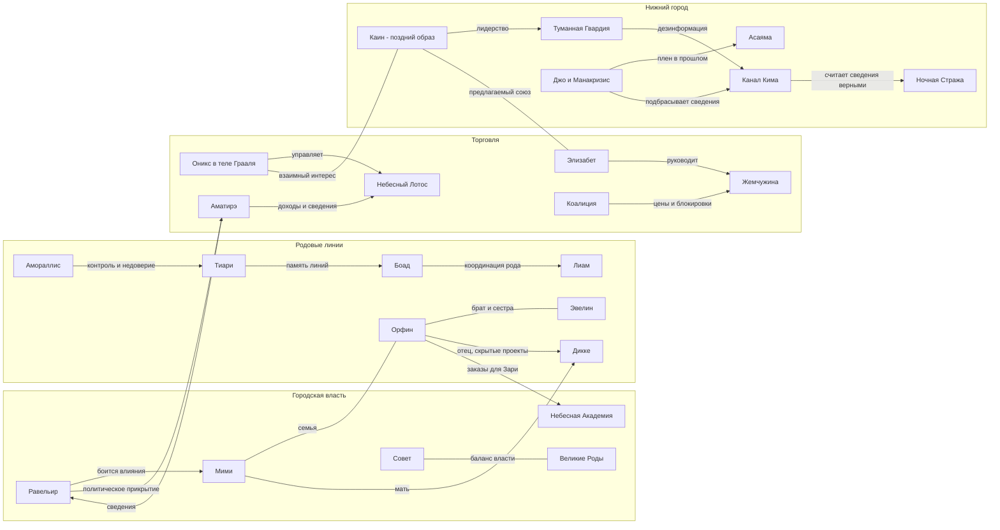

# Карта связей

Карта показывает главные отношения **переработки** и отделённые тайны ведущего. Ранние составы Совета и исходы циклов на неё не наложены. Стрелка обозначает подписанную связь, а не подчинение по умолчанию.

Источники: [[04 Прошлые кампании/Переработка/Интриги верхнего города.md|интриги]], [[01 Мир/Личности и организации верхней Хисуи.md|верх]], [[01 Мир/Нижний город.md|низ]], [[04 Прошлые кампании/Переработка/Игроки — текущий цикл.md|игроки]]. Связь Каин—Элизабет обозначена как предлагаемый союз: степень его реализации в записях неодинакова.

## Тайны и предметы

| Узел | Кто знает / действует | Чего не следует утверждать |
| --- | --- | --- |
| Грааль заперт, Оникс занимает тело | Аматирэ знает или подозревает; Дов замечает изменения, Рейна — финансовые несоответствия. | Что все трое уже знают правду. |
| Затмение | Ношоку готовит; Мими не знает истинной цели. | Что вся церковь посвящена. |
| Резервуары | Орфин скрывает масштаб от семьи и Совета. | Что проект уже работает в городе. |
| Амораллис — агент | Дворянство; сама не знает в переработке, пробуждена в поздних фактах. | Что любой поступок ранней Амораллис — сознательный приказ Дворянства. |
| ЭМИ-план | Каин; Асаяма увидел часть по финансам; осведомлённость Джо предположительна. | Что Ночная Стража уже раскрыла план. |
| Сердце города | Джек похищает, Дворянство владеет в ранних линиях. | Что это сердце джина у Мари. |
| Сердце джина | Вайолет → перехват Боадом → кража Соломоном → потеря → у Мари по сводке. | Что вся цепь показана в отчётах сцен. |
| Массивы и Бог попаданцев | Создатель, Натрисс, Эйдолон; Бэндан связан с системой. | Что Бэндан знает всю космологию. |

Источники: [[04 Прошлые кампании/Переработка/Интриги верхнего города.md|интриги]], [[01 Мир/Личности и организации верхней Хисуи.md|верх]], [[01 Мир/Нижний город.md|низ]], [[04 Прошлые кампании/Переработка/Игроки — текущий цикл.md|игроки]], [[04 Прошлые кампании/Хронология/Личные Линии/!Основной.md|линии]], [[05 Идеи и сцены/Набрасывание фактов.md|факты]], [[05 Идеи и сцены/Доски/Айзек.canvas|доска Айзека]].

## Сеть расследований

Равельир ← Аматирэ ← «Лотос» — сведения о подмене и торговле. Дикке → Орфин → Академия — технические поручения ведут к тайным проектам. Квинт → Кая/«Чёрная Кровь» и Мари/сердце джина — семейная линия связывает приют и сделки элит. Ниэль → Боад/Эстарон и Квиксейв/консоль — политика ведёт к Массивам. Это маршруты по имеющимся отношениям; порядок будущих сцен свободен.
